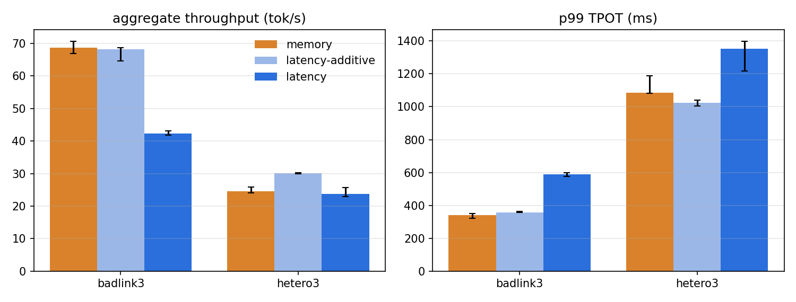
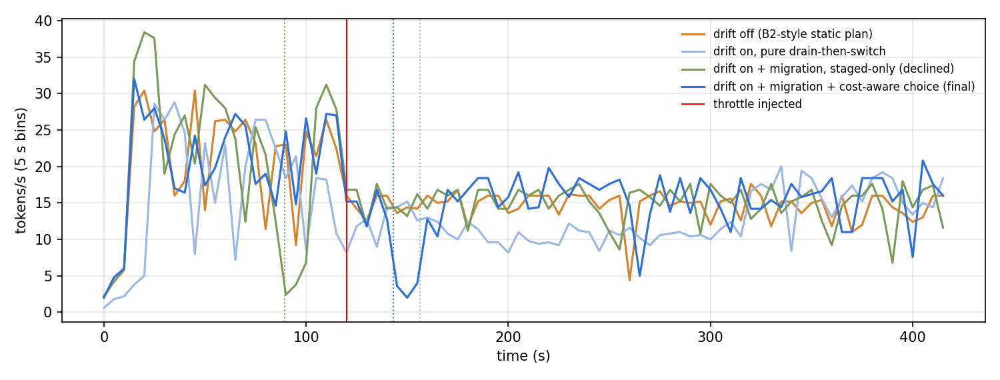
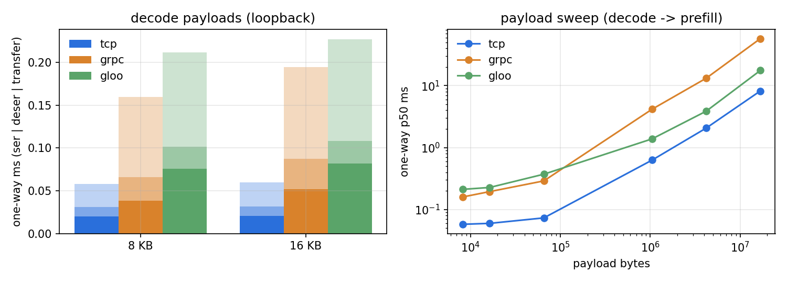

# LANShard: device-aware LLM layer partitioning over Wi-Fi

[](https://github.com/EroNinja/lanshard/actions/workflows/tests.yml)

**CSE 598, Fall 2026, Team 20**: Omer Kuyucu (lead), Ashwanth Balakrishnan, Faisal Barkat Khorasi.
Final report due **December 5, 2026**. Read [`REPORT.md`](REPORT.md) for the full write-up.

LANShard serves one LLM that fits on **no single laptop** by splitting its layers across 2-5 heterogeneous
laptops on one Wi-Fi network. Unlike llama.cpp RPC or exo, which split once by free memory, LANShard splits by
**measured per-layer speed** and **re-splits when a laptop slows down** (thermal throttling), without
pausing service.

---

## Contents

1. [Project status](#project-status)
2. [Results at a glance](#results-at-a-glance)
3. [How it works](#how-it-works)
4. [Repository layout](#repository-layout)
5. [Install](#install)
6. [Run it](#run-it)
7. [Experiments](#experiments)
8. [Tests and CI](#tests-and-ci)
9. [Contributing and code review](#contributing-and-code-review)
10. [Limitations and open TODOs](#limitations-and-open-todos)
11. [AI assistance](#ai-assistance)

---

## Project status

| Area | State |
|---|---|
| System: I1 profiling, I2 partitioner, I3 repartitioning, I4 batching, 3 transports, API | ✅ implemented and tested |
| RQ1 (measured-time vs memory partitioning) | ✅ run on one laptop (emulated cluster), 3 repeats |
| RQ2 (drift-triggered repartitioning) | ✅ run on one laptop, 7-min runs, 4 variants |
| RQ3 (gRPC vs TCP vs Gloo) | ✅ loopback + emulated Wi-Fi |
| Quality vs single machine (MMLU, GSM8K, exact match) | ✅ 300 MMLU / 60 GSM8K |
| B1 single-machine baseline | ✅ |
| B3 llama.cpp `--rpc` baseline | ⏳ harness written, **not run** |
| Run on real separate laptops (required by the proposal) | ⏳ **TODO for the team** |
| Proposal-scale runs (5 repeats, 30-min RQ2, 1000 MMLU / 500 GSM8K) | ⏳ scripts ready (`bench/run_all.py`) |

## Results at a glance

All numbers below come from **one laptop** (RTX 4060 Laptop GPU) running several workers with emulated
heterogeneity. See [Limitations](#limitations-and-open-todos) before quoting them.

| Question | Finding |
|---|---|
| **RQ1**: split by measured time vs free memory | **+12-21% throughput** on heterogeneous devices, lower pipeline bubble, equal or better p99 TPOT. The proposal's "compute + RTT" stage cost was wrong for throughput, so hop latency is now a tie-breaker. |
| **RQ2**: re-split when a laptop throttles | Pure drain-then-switch (as proposed) **lost 12%** of tokens. With staging-aware plans, straggler migration and a cost-aware switch decision: **+10% steady-state throughput** vs a static split, **zero pause** (switch in < 1 s). |
| **RQ3**: per-hop transport cost | **Raw TCP is best.** gRPC adds +0.1 ms per 8 KB decode hop and +49 ms per 16 MB prefill hop; Gloo is in between. Wi-Fi jitter (~40 ms p99) dwarfs all of these. |
| **Quality** vs one GPU | MMLU 62.0% vs 62.3%, GSM8K 50% vs 50%, 99.7% same answers. A single request is bit-identical, even across a mid-generation re-split. |

| RQ1 | RQ2 |
|---|---|
|  |  |

RQ3 transport cost: 

Every table is regenerated from raw data into [`results/figures/tables.md`](results/figures/tables.md) by
`python bench/plot.py`.

## How it works

```
            ┌──────────── coordinator ─────────────┐
 requests → │ queue · scheduler · planner · drift  │   OpenAI-compatible HTTP API
            │ embedding            sampling/LM head │
            └──────┬───────────────────────▲───────┘
         hidden    │                       │ hidden
                   ▼                       │
            worker A [0:k) → worker B [k:m) → worker C [m:L)
            (own layers + own KV cache + one data endpoint each)
```

| Idea | Where | What it does |
|---|---|---|
| **I1** discovery + profiling | `lanshard/probe.py` | A joining node reports OS, accelerator and free memory, then times one real decoder layer of the target model at decode batch sizes 1-8 and a 256-token prefill. It also measures RTT to every peer. |
| **I2** partitioner | `lanshard/partitioner.py` | Exact DP over contiguous layer ranges that minimises the slowest stage, subject to per-node memory (weights + KV reserve), searching every ordered subset of nodes (N ≤ 5). Hop latency overlaps with pipelining, so it only breaks ties. `--policy latency-additive` keeps the proposal's original model; `--policy memory` is the exo / llama.cpp baseline (B2). |
| **I3** drift-triggered repartitioning | `lanshard/coordinator.py` (`_drift_loop`, `_choose_plan`, `install_plan`) | When a node is >25% slower than its baseline for 30 s, or leaves, the coordinator prices three options over a 5-minute horizon: **keep** the plan, a **staged** plan (new layers fit next to the old ones, so zero pause), or an **unconstrained** plan that needs a short pause. It switches only for a ≥10% predicted gain. Long in-flight requests **migrate** to the new plan by re-prefill (token-identical); short ones finish in place. |
| **I4** phase-aware continuous batching | `lanshard/coordinator.py` (`_form_batches`) | Packed micro-batches mix many requests. Decode batches are the smallest that keep the measured pipeline depth busy; prefill runs in separate 512-token chunks. |
| Transports | `lanshard/transport.py` | One `send` / `on_message` interface with raw length-prefixed **TCP** (default), **gRPC** (protobuf) and **Gloo** (pairwise groups created at runtime). `NetemProfile` emulates Wi-Fi delay, jitter, spikes and bandwidth on any OS. |

Workers load **only their own layers** straight from the safetensors shards: the model skeleton is built on
PyTorch's `meta` device, so it costs no memory. Any Hugging Face decoder with standard layer names works
(Llama, Qwen2/3, Mistral). The norms, projections, MLP and RoPE are the stock HF modules. Attention is our own
packed, per-request implementation, so prefill chunks and decode tokens from different requests share one
forward pass.

## Repository layout

```
lanshard/            the system
  coordinator.py     queue, scheduler (I4), planner calls (I2), drift monitor + replanning (I3), sampling
  worker.py          worker process: owns layers + KV cache, serves micro-batches, reports stats
  partitioner.py     DP partitioner, memory-proportional baseline, staging constraint, plan cost
  probe.py           device discovery + per-layer profiling (I1), slowdown emulation
  model_utils.py     load layer slices from safetensors, packed-attention stage runner, KV store
  transport.py       TCP / gRPC / Gloo stage channels, netem emulation, control-plane JSON
  api.py             OpenAI-compatible HTTP server
  cluster.py         run a whole cluster on one machine
bench/               experiment scripts (see Experiments), plotting, cluster presets
tests/               unit + end-to-end tests
results/             every run's raw data (CSV/JSON/logs) + figures/ (plots and tables)
REPORT.md            the report
```

Each `results/<timestamp>-<name>/` folder contains:

* `summary.json`: headline metrics and config;
* `requests.csv`: per-request TTFT, TPOT and inter-token latencies;
* `microbatches.csv`: per-micro-batch compute / network / queue / deserialisation split;
* `node_stats.csv`: per-node busy time, drift ratio and memory;
* `devices.csv`: the discovery-probe device table;
* `run.json`: plans, events and the RTT matrix;
* `logs/`: worker logs.

Folders starting with `_` are earlier or failed attempts, kept as evidence and referenced in the report.

## Install

```bash
pip install -r requirements.txt
```

Python 3.10+ and PyTorch 2.x. Workers can be CUDA, Apple MPS or CPU-only, on any mix of Windows, macOS and
Linux. Models download from Hugging Face on first use (Qwen2.5-0.5B/1.5B-Instruct, about 1 GB and 3 GB).

## Run it

**On real laptops (same Wi-Fi).** On the coordinator machine:

```bash
python -m lanshard.coordinator --model Qwen/Qwen2.5-1.5B-Instruct --workers 3 --http 8000
```

On each worker laptop:

```bash
python -m lanshard.worker --coordinator <coordinator-ip>:29500
```

Workers are discovered when they join; nothing about the devices is configured in advance. After profiling,
the coordinator prints the plan and serves an OpenAI-compatible API:

```bash
curl http://<coordinator-ip>:8000/v1/chat/completions -d "{\"messages\":[{\"role\":\"user\",\"content\":\"hi\"}],\"max_tokens\":64}"
```

`GET /status` shows the plan, per-node profiles, RTTs, drift ratios, busy time and memory.

**Useful flags.**

* `--transport tcp|grpc|gloo`: must be the same on every node.
* `--policy latency|latency-additive|memory|even`.
* `--no-drift`: turn off repartitioning.
* `--netem wifi|profile.json|base=..,jitter=..`: emulate a Wi-Fi link.
* Worker only: `--device cuda|mps|cpu`, and `--slowdown 2` / `--mem-limit-gb 3` to emulate a slower or
  smaller device.

**On one machine (emulated cluster).** A worker is a process, not a machine:

```bash
python -m lanshard.cluster --model Qwen/Qwen2.5-0.5B-Instruct --worker id=gpu-a --worker id=gpu-b,slowdown=2 --worker id=cpu,device=cpu --prompt "Explain pipeline parallelism."
```

## Experiments

| Script | What it measures |
|---|---|
| `bench/serve.py` | **RQ1 / B2.** ShareGPT-like replay through a preset cluster (`bench/clusters.py`), any policy. Reports throughput, TTFT, TPOT p50/95/99, per-hop split, bubble ratio and peak memory. `--sharegpt file.json` replays real ShareGPT conversations. |
| `bench/sustained.py` | **RQ2.** Closed-loop load; throttles one node mid-run; compares drift on and off, and pure drain vs migration. |
| `bench/rq3_transport.py` | **RQ3.** Ping-pong over the real stage channel for each backend, 8 KB-16 MB. Use `--netem wifi`, or `--peer` for two real hosts. |
| `bench/quality.py` | Greedy exact match plus MMLU / GSM8K accuracy, LANShard vs B1. |
| `bench/b1_single.py` | **B1.** Whole model in stock Transformers on one GPU. |
| `bench/b3_llamacpp_rpc.py` | **B3.** `llama.cpp --rpc` on the same machines (needs llama.cpp binaries and a GGUF). |
| `bench/measure_rtt.py` | Measures real Wi-Fi RTT between two laptops and writes a netem profile. |
| `bench/run_all.py` | Everything above, then `plot.py`. `--quick` is about 1.5 h on one laptop; without it you get proposal scale. |
| `bench/rerun_after_fixes.sh` | Re-runs the experiments affected by the design fixes in REPORT.md section 5. |
| `bench/plot.py` | Rebuilds every figure and table in `results/figures/`. |

## Tests and CI

```bash
python -m pytest tests -q
```

The tests cover:

* the DP against brute force (both cost models) over every order and split;
* memory and staging constraints;
* round-trip and FIFO order on all three transports;
* netem ordering.

With the 0.5B weights cached, they also check exact greedy agreement with HF and token-identical output
across staged and paused mid-generation re-splits (about 2 min; `LANSHARD_SKIP_SLOW=1` skips these).
GitHub Actions runs the suite on every push and PR (CPU-only; the model tests skip there).

## Contributing and code review

`main` is protected: changes go in through pull requests with **one approving review** and **passing CI**.

```bash
git clone https://github.com/EroNinja/lanshard.git
cd lanshard
git checkout -b your-change
```

Edit and commit, then:

```bash
python -m pytest tests -q
git push -u origin your-change
gh pr create
```

* **Reviewing the existing code:** the initial codebase is open as one big **review PR** (the "Review:
  initial codebase" PR). Please comment on specific lines there, then approve or request changes.
* **Bugs or questions:** open a GitHub Issue.
* **Results:** commit new runs under `results/` (keep the auto-generated folder names) and re-run
  `bench/plot.py`.
* **Meetings:** Saturdays on Zoom (from the proposal). Tasks live as GitHub Issues.

## Limitations and open TODOs

* **One machine.** Two "GPU laptops" share one physical GPU, which understates the RQ1 gain and adds
  contention noise to drift detection. **TODO:** run `serve.py` / `sustained.py` on 3-4 real laptops, with
  `measure_rtt.py` to calibrate netem from the real Wi-Fi.
* **Thermal drift.** The laptop GPU heated to 83 °C during the session, so compare only runs taken close
  together (start times are in the report).
* **Few repeats.** 3 per RQ1 config and 1 per RQ2 variant. **TODO:** `bench/run_all.py` without `--quick`.
* **Model size.** 1.5B in FP16. 8B is untested (the code is model-agnostic).
* **B3 not run.** **TODO:** llama.cpp RPC baseline.
* **Intermittent stall.** An intermittent stall appeared in 2 early runs. The root cause is not found; it is
  mitigated by micro-batch retransmit, with diagnostics that dump stacks if it recurs (REPORT.md section 5).
* **RTT is measured once at join.** Link drift is not re-measured.

## AI assistance

The implementation, experiments and report were produced with substantial help from an AI coding assistant
(Claude Code). The team is responsible for reviewing the design, the code and every claim before submission;
that is what the review PR is for.
