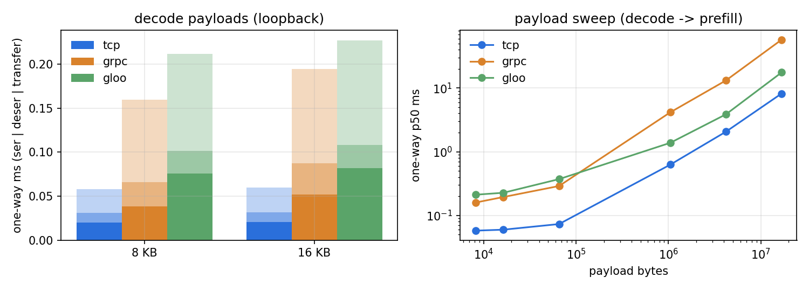
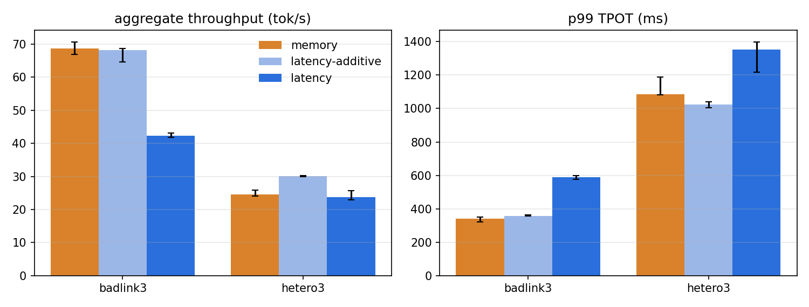
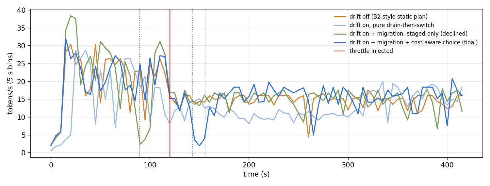

# LANShard: Device-Aware LLM Layer Partitioning over Wi-Fi

CSE 598 Final Report, Fall 2026. Team 20: Omer Kuyucu (lead), Ashwanth Balakrishnan, Faisal Barkat Khorasi.

> **Summary.** We built LANShard: a coordinator plus workers that serve one LLM pipelined across
> heterogeneous machines. It has per-layer profiling, an exact DP partitioner, drift-triggered
> repartitioning, continuous batching, and three swappable transports. All experiments ran on one laptop
> with emulated heterogeneity (CPU worker, slowed GPU worker, memory caps, Wi-Fi delay emulation).
>
> * **RQ1:** partitioning by measured layer time beats memory-proportional partitioning by **+9% and
>   +16% throughput** on heterogeneous devices in the two same-workload back-to-back pairs, with a lower
>   bubble ratio and equal or better p99 TPOT. The
>   proposal's "compute + RTT" stage cost was wrong for throughput: it starved a bad-link node for no gain.
>   Hop latency overlaps with pipelining, and the fixed model treats it as a tie-breaker.
> * **RQ2:** pure drain-then-switch, as proposed, *lost* 12% of tokens after a throttle, because the old
>   split lives as long as the longest request. With staging-aware replanning, straggler migration and a
>   cost-aware switch decision, the cluster keeps **+10% steady-state throughput** over a static plan
>   (+3% over the first 5 minutes, which include the migration cost), with zero admission pause.
> * **RQ3:** raw TCP is the best stage channel. gRPC adds ~0.1 ms per 8 KB decode hop and ~49 ms per 16 MB
>   prefill hop. Gloo sits in between. Under Wi-Fi-like jitter, variance (~40 ms p99) dwarfs all of this.
> * **Quality:** MMLU and GSM8K accuracy match single-machine Transformers (62.0 vs 62.3%, 50 vs 50%).
>   Single-request output is bit-identical, including across mid-generation repartitions.
> * **Caveats:** one machine, thermal drift over the session, few repeats, model size 1.5B. Section 6 lists
>   what must be re-run on real laptops before these numbers are final.

## 1. Problem

A model that fits on no single laptop can be served by pipelining its layers across several laptops on one
Wi-Fi network. Existing systems (llama.cpp RPC, exo, Petals) decide the split once, from free memory. We set
out to test three claims from our proposal:

* **RQ1.** Partitioning by *measured per-layer time* (plus measured hop latency) beats memory-proportional
  partitioning on throughput and p99 TPOT when devices are heterogeneous.
* **RQ2.** Repartitioning when a node's stage time drifts (thermal throttling) holds throughput steady, and
  drain-then-switch avoids moving or recomputing KV cache.
* **RQ3.** At decode payloads of 8-16 KB per hop, we measure how much latency gRPC and torch.distributed/Gloo
  add over raw TCP.

## 2. System

LANShard is about 3,100 lines of Python on PyTorch and Hugging Face Transformers (`lanshard/`).

```
            ┌──────────── coordinator ─────────────┐
 requests → │ queue · scheduler · planner · drift  │
            │ embedding            sampling/LM head │
            └──────┬───────────────────────▲───────┘
         hidden    │                       │ hidden
                   ▼                       │
            worker A [0:k) → worker B [k:m) → worker C [m:L)
            (own layers + own KV cache + one data endpoint each)
```

**Workers load only their own layers.** The architecture is instantiated on PyTorch's `meta` device, so it
takes no memory. The worker picks out its decoder layers and fills them from just the safetensors tensors it
needs. The coordinator does the same for the embedding, final norm and LM head. Any HF decoder checkpoint with
the standard `model.layers.N.*` layout works (Llama, Qwen2, Qwen3, Mistral), including the model's own RoPE
scaling.

**Packed attention.** The norms, projections, MLP and rotary embedding are the stock HF modules. Attention is
our own and runs over a *packed* micro-batch: a list of segments `(request, start position, n tokens)`. All
linear layers run once over the concatenated tokens. Attention runs per segment against that request's KV
cache, which is pre-allocated per request on each worker for its own layers only. One message can therefore
carry a 512-token prefill chunk or eight single decode tokens from eight requests. For a single request the
greedy output is **token-identical** to `transformers.generate` (tested with a two-stage split and chunked
prefill, `tests/test_model.py`).

**I1, discovery and profiling** (`probe.py`). A joining node reports host, OS, accelerator, free VRAM/RAM
(unified memory on Apple silicon). It then times one real decoder layer of the target model: decode micro-batches
of 1, 2, 4 and 8 tokens over a 512-token context, and a 256-token prefill. Nodes are profiled one at a time,
so co-located workers do not disturb each other. Every worker also measures RTT to every peer and to the
coordinator, with an 8 KB (hidden-size) payload.

**I2, the partitioner** (`partitioner.py`). Stage cost is `m·t_layer(node, b) + RTT(node→next)/2`, where `b`
is the planning micro-batch. The planner minimises the maximum stage cost (ties broken by total latency) over
contiguous ranges, subject to
`m·(mem_layer + kv_reserve_per_layer) + overhead ≤ mem_free`. The DP is exact and O(L²N) per order. With
N ≤ 5 we also enumerate every ordered subset (≤ 325 orders), so a slow-link node is placed last or dropped.
Planning takes 3-50 ms in Python for three nodes (about 1 s for five). A test checks it against brute
force over all orders and splits.

**I3, drift-triggered drain-then-switch** (`coordinator._drift_loop`, `install_plan`). Workers report a 10 s
rolling median of *observed / profiled* stage time on decode micro-batches. The coordinator calibrates a
per-node baseline over the first 15 s of serving. A node more than 25% over its baseline for 30 s, or a node
that disappears, triggers a replan with that node's `t_layer` scaled by the observed drift. Workers stage any
new layers in the background. Admission then switches to the new plan version, while in-flight requests keep
using the old one: every message names its plan version, and workers hold both layer sets until the old plan
drains. If old+new layers exceed a worker's capacity, it refuses, and the coordinator pauses admission, drains,
releases, and reloads. Only a node *loss* forces recomputation: those requests are re-queued with their
generated text as the new prompt.

**I4, phase-aware continuous batching** (`coordinator._form_batches`). Requests are admitted against a
KV-token budget. Decode micro-batches have size `ceil(R/D)`, where R is the number of decoding requests and D
is the pipeline depth needed to keep every stage busy. D is measured online as (queue-free loop time) /
(slowest stage time), so it accounts for hop RTT. Prefill goes in separate 512-token chunks with their own
in-flight slot, so a long prompt does not inflate decode TPOT.

**Transport** (`transport.py`). One interface (`send(header, tensor)` / an `on_message` callback) has three
backends:
* raw length-prefixed TCP with `TCP_NODELAY`;
* gRPC client-streaming with a real `google.protobuf.BytesValue` per message;
* torch.distributed Gloo. Gloo uses a two-rank `ProcessGroupGloo` per link, bootstrapped over a small TCP
  rendezvous, so links form at runtime with no global world size. This is a necessity for dynamic join.

Sends happen on a background thread, so serialisation and socket writes overlap compute.
`NetemProfile`/`DelayedSender` provide `tc netem`-style one-way delay, half-normal jitter, retransmission
spikes and a bandwidth term, preserving FIFO order. It runs on any OS and can replay a delay distribution
measured on real Wi-Fi (`bench/measure_rtt.py`).

**Front end.** There is an OpenAI-compatible `/v1/chat/completions` (streaming and non-streaming) and
`/status`. `python -m lanshard.cluster` runs a whole emulated cluster on one host.

## 3. Experimental setup

**What we could run.** All numbers here come from **one laptop**: Windows 11, RTX 4060 Laptop GPU (8 GB),
16 logical cores, 16 GB RAM. We used the proposal's fallback (section 8): a worker is a process, not a
machine. Heterogeneity is produced by real mechanisms, not by editing results:

* a **CPU-only worker** (computes in FP32);
* a **wall-clock slowdown**: after each forward, the worker waits `(factor-1)×` the measured compute time, so
  the profiler and the runtime both genuinely see a slower device;
* **advertised memory caps**: the planner and the staging check both enforce them;
* **netem-style link emulation** on every outbound hop. "wifi" is 1.5 ms base + half-normal jitter
  σ=2.5 ms + 1% chance of a 30 ms retransmission spike + 400 Mbps, giving the 2-20 ms RTT range from the
  proposal. The bad link is 8 ms base, σ=6 ms, 3% × 40 ms spikes, 100 Mbps.

| preset | nodes (advertised memory) | used for |
|---|---|---|
| `hetero3` | gpu-fast (2.0 GB), gpu-slow = 2× slowdown (1.5 GB), cpu-only = CPU + 1.5× (1.6 GB) | RQ1, RQ2, quality |
| `badlink3` | three equal GPU workers (2.0 GB each), one behind the bad link | RQ1 (C3) |

**Model:** Qwen2.5-1.5B-Instruct, FP16 (28 layers, ~89 MB/layer in FP16, 178 MB in FP32 on the CPU node),
from the proposal's model tiers. The memory caps are scaled so the cluster holds only ~33 layers in total,
so the model fits on no single node and the split is memory-constrained, as with 8B on real laptops.

**Workload:** ShareGPT-like lengths (log-normal; prompts 100-1000 tokens, median 300; outputs 50-300,
median 120), real token ids, Poisson arrivals at 1.5 req/s, 40 requests per run, `ignore_eos` so lengths
are controlled. `bench/serve.py --sharegpt file.json` replays real ShareGPT conversations instead.
RQ2 uses closed-loop load (12 concurrent clients) for 420 s, with gpu-fast throttled 2.5× at t = 120 s.

**Baselines.** B1 = the whole model in stock `transformers` on the same GPU, one request at a time.
B2 = our system with memory-proportional partitioning and no drift handling (exo / llama.cpp-RPC policy).
B3 = `llama.cpp --rpc`: the harness is in `bench/b3_llamacpp_rpc.py`, but we did **not** run it (it needs
llama.cpp binaries and a GGUF; see Limitations).

## 4. Results

Raw data for every run is in `results/<timestamp>-<name>/` (config, per-request, per-micro-batch and
per-node CSVs, worker logs). Tables are regenerated by `bench/plot.py` into `results/figures/tables.md`.

### 4.1 RQ3: transport cost per hop



Ping-pong between two processes over the real stage channel. One-way = RTT/2; serialisation and
deserialisation are measured locally.

| payload | TCP one-way | gRPC added | Gloo added | gRPC ser + deser |
|---|---|---|---|---|
| 8 KB (decode, hidden 4096) | 0.058 ms | **+0.10 ms** | +0.15 ms | 0.07 ms |
| 16 KB | 0.060 ms | +0.14 ms | +0.17 ms | 0.09 ms |
| 1 MB | 0.63 ms | +3.5 ms | +0.76 ms | 2.1 ms |
| 16 MB (2k-token prefill) | 8.2 ms | **+49 ms** | +9.4 ms | 25.7 ms |

* **Raw TCP wins at every size**, as the proposal guessed. It is the default.
* **Decode:** gRPC costs ~0.1 ms more per hop, less than 1% of a stage's compute here, but it is pure overhead
  that grows with the number of hops.
* **Prefill:** at 16 MB gRPC's protobuf copy and HTTP/2 framing add ~50 ms per hop. That matters for TTFT.
* **Gloo** sits between the two. It also needs a rendezvous per link, which makes dynamic membership awkward.
* **Under emulated Wi-Fi** (`rq3_transport_wifi.png`) every backend's 8 KB RTT is ~7.5-8.5 ms median and
  ~37-43 ms at p99. **The jitter is ~300× larger than the backend difference**, which confirms C3:
  variance, not the transport, is the problem. A 16 MB hop costs ~0.35 s one-way at 400 Mbps, matching the
  proposal's 0.3 s estimate. (In the netem runs the serialisation column reads 0 because it happens on the
  delayed sender's thread; the loopback run measures it.)

### 4.2 RQ1: partitioning by measured time vs by free memory



`memory` = B2 (layers ∝ free memory, join order). `latency-additive` = our planner with the proposal's cost
model (stage = compute + hop RTT/2). `latency` = our planner after the fix in section 5 (stage = compute;
the hop overlaps other stages' compute and only breaks ties). Drift handling is off for all RQ1 runs, so this
isolates I1+I2 against B2. Start times (hh:mm) are listed because the laptop heated up over the session,
see below.

**`hetero3` (heterogeneous compute).** Each row is one 40-request run.

| start | policy | plan (layers per node) | predicted bottleneck | tok/s | TPOT p50 / p99 ms | bubble |
|---|---|---|---|---|---|---|
| 13:14 | latency-additive | cpu 6 · slow 8 · fast 14 | 52.7 ms | **30.6** | 710 / 988 | 0.39 |
| 13:19 | memory | cpu 6 · slow 11 · fast 11 | 87.5 ms | 27.2 | 800 / 1081 | 0.45 |
| 13:26 | latency-additive | slow 7 · fast 15 · cpu 6 | 64.4 ms | **29.7** | 745 / 1058 | 0.37 |
| 13:30 | memory | cpu 6 · slow 11 · fast 11 | 86.7 ms | 24.5 | 806 / 1084 | 0.45 |
| 15:38 | memory | cpu 6 · slow 11 · fast 11 | 94.7 ms | 23.7 | 952 / 1293 | 0.40 |
| 15:45 | latency | slow 8 · cpu 5 · fast 15 | 55.5 ms | **27.6** | 829 / 1081 | 0.34 |
| 15:51 | latency | cpu 6 · fast 15 · slow 7 | 101.9 ms* | 22.1 | 1007 / 1446 | 0.35 |
| 15:57 | latency | slow 7 · fast 15 · cpu 6 | 94.3 ms* | 23.7 | 836 / 1351 | 0.32 |

\* The profiles taken at 15:51 and later are ~1.8× slower across all nodes: the GPU had reached 83 °C after
three hours of back-to-back runs. The *plans* are still the same shape (fast GPU gets 15 layers).

* **The planner does what C1 says it should.** B2 gives the 2×-slower GPU as many layers as the fast one
  because their memory is similar. Our planner moves 3-4 layers from the slow GPU to the fast one, which
  cuts the predicted bottleneck by ~40% (87-95 ms → 53-64 ms).
* **Measured gain is real but smaller than predicted.** Only two pairs ran the same workload (same seed)
  minutes apart: 29.7 vs 27.2 tok/s (13:26 vs 13:19, seed 1, **+9%**) and 27.6 vs 23.7 tok/s (15:45 vs
  15:38, seed 0, **+16%**). In both, measured-time partitioning ran second, on the hotter GPU. The mean
  bubble ratio falls from 0.40-0.45 to 0.32-0.39, and p99 TPOT is equal or better in both pairs.
  (Correction: an earlier version of this bullet reported "+12% to +21%" from 30.6 vs 27.2 and 29.7 vs
  24.5. Those pairs used different seeds, so they compared different requests; rows 13:14, 13:19, 13:26
  and 13:30 are seeds 0, 1, 1 and 2. For the final `latency` policy there is one valid pair.)
* **Why not +65%:** our emulation of the slow GPU waits *after* its forward, which leaves the shared physical
  GPU free for the fast worker. Giving the "slow GPU" extra layers in B2 is therefore cheaper here than it
  would be on a real separate slow laptop. Pipeline depth (≤ 12 micro-batches) and the coordinator's
  per-token work also cap throughput. We expect the gap to be larger on separate hardware; that is the first
  thing to check with real laptops.
* **Not every run wins.** The two late runs (22.1, 23.7) are slower than the early B2 runs because of
  thermal throttling, which is the effect RQ2 is about, showing up uninvited. Comparisons are only meaningful
  between runs taken close together.

**`badlink3` (equal compute, one bad link).**

| policy | runs (start) | plan | tok/s (each run) | TPOT p99 ms |
|---|---|---|---|---|
| memory | 14:18-14:30 | 10 · 9 · 9 (bad link gets 9) | 72.6, 68.8, 65.0 | 300-356 |
| latency-additive | 14:21-14:33 | bad link gets **7-8** | 68.2, 69.1, 61.1 | 353-373 |
| latency (fixed model) | 16:04-16:13 (hot GPU) | 10 · 9 · 9, same as memory | 42.3, 44.0, 41.3 | 568-610 |

* **The proposal's cost model was wrong for throughput.** Adding hop RTT to stage time made the planner take
  layers away from the bad-link node (7-8 instead of 9). That gave **no gain and slightly lower median
  throughput (68.2 vs 68.8 tok/s) and higher p99 TPOT**. With continuous batching there are 4-12
  micro-batches in flight, so a hop's latency overlaps other stages' compute and does not limit throughput;
  only the link's *occupancy* (bytes / bandwidth, ~0.1 ms for 8 KB) does.
* **The fixed model** (section 5) treats hop latency as a tie-breaker. On equal devices it reproduces the
  memory split, which is the right answer here. The lower absolute numbers of those three runs come from the
  hot GPU (per-stage compute ~2× slower at 83 °C, same plan), not from the policy.
* **Hop latency still matters for single-stream latency** (TTFT, TPOT at low load). The planner still
  minimises it, as the tie-breaker. A node on a link so bad that bytes/bandwidth exceeds its compute will
  still be given fewer layers or dropped.

### 4.3 RQ2: drift-triggered repartitioning



Closed-loop load on `hetero3` (12 concurrent clients, latency policy). At t = 120 s gpu-fast, which holds
15-16 of the 28 layers, is throttled to 2.5× slower for the rest of the run. Each variant is one 420 s run.
The variants differ only in how I3 reacts:

| variant | tok/s before | steady tok/s after | retained | tokens in the 300 s after the throttle | switch (load time) | TPOT p99 |
|---|---|---|---|---|---|---|
| drift off (static plan, as B2) | 21.6 | 14.5 | 67% | 4308 | - | 833 ms |
| drift on, pure drain-then-switch | 18.5 | 12.8 | 69% | 3781 (**−12%**) | 1.0 s | 2017 ms |
| drift on + migration, staged plans only | 20.3 | 15.0 | 74% | 4422 (+3%) | 0.2 s | 819 ms |
| **drift on + migration + cost-aware choice (final)** | 21.8 | **15.9** | 73% | **4426 (+3%)** | 0.7 s | 971 ms |

(Run-to-run noise in the "before" column is ±2 tok/s; compare *retained* and the post-throttle columns.
A second static run, `results/_rq2-repro-drift-off`, gave 25.4 before and 13.2 after the throttle, so
the post-throttle baseline also varies by about 10% between runs.)

* **Detection works.** Every drift-on run flagged gpu-fast 30-35 s after the throttle (the 30 s sustain
  window) with an estimated slowdown of 2.2-3.3×. The true value is 2.5×, plus contention from the shared GPU.
* **The switch itself is no longer the cost.** With the staging-aware DP the new layers load next to the old
  ones in 0.2-1.0 s, with **no admission pause**. Our first attempt (section 5) paused for ~100 s per switch.
* **Pure drain-then-switch, as proposed, made things worse** (−12% tokens). For the ~155 s it took the old
  plan's 300-token requests to finish, the throttled node served both plans. This is the real cost of C2:
  never migrating anything means living with the old split for as long as the longest request.
* **Migrating stragglers fixes that.** Moving long requests to the new plan by re-prefilling them takes
  ~15 s (the dip after the dotted line in the plot), after which the new plan runs alone. The final variant
  keeps **15.9 tok/s against 14.5 for the static plan (+10%) in steady state**. Over the 5 minutes after the
  throttle it nets +3% because it pays the migration dip first. On the proposal's 30-minute run the
  steady-state gain dominates, so we expect ≈ +9%.
* **The cost-aware choice behaves sensibly.** In the "staged plans only" run, a contention-induced drift on
  gpu-slow at t = 90 s had already used the cluster's spare memory. When the real throttle came, the best
  stageable plan gained only 6%, so the system declined it. The final version also prices an unconstrained
  plan that needs a short pause (estimated 10 s) over a 5-minute horizon. Here the staged plan was the best
  option (+36% predicted bottleneck improvement), so no pause was taken.
* **Why the gain is ~10% and not more:** memory. With 33 layers of capacity for a 28-layer model, the other
  nodes can absorb only ~5 layers from the throttled one. The best achievable bottleneck after the throttle
  is ~119 ms, against 45-50 ms before it. Repartitioning cannot beat physics; it can only stop the slow node
  from setting the pace with an oversized stage.
* **RQ2's second question, the KV cost of repartitioning:** we never migrate KV. We stage weights (~90 MB
  per moved layer, 0.1 s each from local disk). For requests that would otherwise outlive the old plan, we
  recompute their KV via re-prefill (~15 s for 7 requests of ~400-1300 tokens on this cluster). Requests
  with < 32 tokens left finish in place. Re-prefilled requests produce token-identical output
  (`tests/test_cluster.py`).

### 4.4 Output quality vs a single machine

Same weights, greedy decoding. B1 runs the whole model on one GPU; LANShard splits it across the
`hetero3` workers, with requests submitted concurrently, so batching, chunked prefill and the FP32 CPU stage
are all exercised.

| task | B1 accuracy | LANShard accuracy | same final answer | greedy token-exact match |
|---|---|---|---|---|
| MMLU, 300 questions | 62.3% | 62.0% | 99.7% | 98.7% |
| GSM8K, 60 problems | 50.0% | 50.0% | 91.7% | 85.0% |
| 50 chat prompts × 128 tokens | - | - | - | 92.0% |

**Accuracy is unchanged.** A single request through a 2-stage split is **bit-identical** to `transformers`
(`tests/test_model.py`). Token divergences come only from (a) FP16 batched matmuls rounding differently from
batch size 1 and (b) the CPU stage computing in FP32. In greedy decoding a near-tie flip early in a long
answer changes the rest of the text, which is why GSM8K, with ~250-token answers, shows the lowest exact
match, yet the answers are equally right. For bit-exact output, run every stage in FP16 with micro-batch 1.

### 4.5 B1 reference

Stock `transformers` with the whole model on the same GPU, one request at a time: **27.7 tok/s,
TPOT p50 36 ms**, 3.0 GB peak VRAM. As the proposal predicted (I4), a pipeline cannot beat one adequate GPU on
single-stream latency: our TPOT is 10-20× higher. The point of LANShard is to run a model that fits on *no*
single machine, and to recover throughput by overlapping requests.

## 5. What the first round of experiments taught us (and what we changed)

The first full run exposed four design problems. Each fix below is in the code and covered by a test, and
every affected experiment was re-run. The pre-fix runs are kept: `latency-additive` in RQ1 and
`drift-on-drain` in RQ2.

1. **Pipeline-depth feedback loop (I4).** Depth was estimated as loop time / stage time, but loop time
   included queueing. Queueing raised the depth estimate, which shrank decode micro-batches (to 1.3 requests),
   which caused more queueing: 665 ms of queue per token. Depth now uses queue-free loop time. Micro-batches
   grew to ~6, queueing fell to ~90 ms, and throughput on the same cluster rose from ~21 to ~31 tok/s.
2. **Hop latency in the stage cost (I2).** As explained in 4.2, adding RTT to stage time is right for
   single-stream latency and wrong for pipelined throughput. Stage cost is now
   `max(compute, link occupancy)`, and RTT is the tie-breaker. The original model remains available as
   `--policy latency-additive`.
3. **Drain-then-switch was not zero-pause (I3).** Two separate problems:
   * The planner packed nodes to their memory cap, so old and new layers could never coexist. Every switch
     fell back to *pause admission → drain → load*, a ~100 s pause per switch (`_rq2-first-attempt`).
     **Fix:** replans now run the DP with a staging constraint: a node may only take a range whose *union*
     with its current range fits its memory. The new layers therefore load next to the old ones (switch in
     ~1 s). The DP falls back to an unconstrained plan only if no such plan exists.
   * Even with an instant switch, old-plan requests (up to 300 tokens) kept the throttled node busy for
     ~155 s. During that window both plans compete, and throughput is *lower* than not repartitioning
     (`drift-on-drain` in 4.3). **Fix:** on a switch, requests with ≥ 32 tokens left are migrated to the new
     plan by re-prefilling their prompt plus generated text. This is C2's "recompute" option, applied only to
     stragglers. The old plan drains in seconds. A test confirms migrated requests produce **token-identical**
     output to an un-repartitioned run (`tests/test_cluster.py`).
   * Restricting replans to stageable plans sometimes left nothing worth doing (a 6% gain, declined). **Fix:**
     the coordinator now prices three options over a 5-minute horizon: keep, staged (zero pause), and
     unconstrained (it earns nothing during an estimated pause, and the estimate is replaced by the measured
     pause after the first one). It picks the best. In the paused path, long requests are re-queued with
     their text so far instead of being waited for. This is also tested for token-identical output.
4. **False drift triggers.** Two "GPUs" sharing one physical GPU produce contention that looks like drift,
   which caused replans before any throttle. **Fix:** drift is ignored for 20 s after a switch, and a replan
   happens only if the planner predicts a ≥ 10% lower bottleneck *under the measured slowdown*
   (`replan_skipped` events record the ones it declines).

### 5.1 Code changes made after these measurements

A later review (`docs/REVIEW.md`) changed code that the numbers above depend on. Nothing was re-measured,
so sections 4.1 to 4.3 describe the code as it was.

* **Emulated bandwidth.** In all runs above the netem rate only delayed each message, and any number of
  messages could be in flight on one link. A link now sends one message at a time. This matters for the
  serving runs (RQ1 and RQ2), and most for `badlink3`: the old emulator could not make a link the
  throughput bottleneck, and a prefill chunk did not hold back the decode tokens behind it. RQ3 is not
  affected, because its ping-pong has one message in flight per link (re-run before and after on a CPU
  machine: same numbers within noise).
* **Link occupancy in the planner.** Item 2 above describes the stage cost as
  `max(compute, link occupancy)`. During these runs the planner was never given a payload size or a
  bandwidth, so the occupancy term was zero. Bandwidth is now measured per link at join and used.
* **Tie-break.** Among plans with the same bottleneck the planner now returns the one with the lowest
  total latency exactly. Plans can differ from the ones listed in 4.2 where several tie.
* **Failure handling.** Silent nodes are dropped after 15 s without a report, and requests fail with an
  error when the surviving nodes cannot hold the model.

**An intermittent stall we did not root-cause.** In 2 of ~16 early runs, 2-3 micro-batches stopped
mid-pipeline with no error anywhere. Once it lasted 38 minutes and then resumed; once it lasted until the end
of the run. Per-node counters showed messages stuck between specific hops. We hardened the obvious suspects:
* control-socket writes moved off the scheduler thread;
* a race in the worker's KV accounting fixed;
* every send/receive error now logged;
* timed-out micro-batches are **retransmitted** (safe because re-running a micro-batch rewrites identical
  KV);
* a native `faulthandler` watchdog dumps every thread if one micro-batch takes > 60 s.

The bug has not recurred in the 10 runs since. If it does, the logs will now show where it is stuck.

## 6. Limitations (please read before quoting numbers)

* **One machine, emulated heterogeneity.** The proposal requires at least one round on separate laptops for
  the headline numbers, and we have not done that yet. Two "GPU laptops" share one physical GPU and its
  CPU. This understates the RQ1 gain (section 4.2) and adds contention noise to drift detection.
* **Thermal drift across the session.** The GPU reached 83 °C after ~3 hours. Per-layer times roughly
  doubled, so absolute throughput is only comparable between runs taken close together. We report start
  times for that reason.
* **Repeats.** 3 repeats per RQ1 configuration (the proposal planned 5) and one 7-minute RQ2 run per variant
  (the proposal planned 30 minutes). Single RQ2 runs vary by ±2 tok/s, so the +10% steady-state result needs
  repeats before it is quoted with confidence. The quality evaluation used 300 MMLU / 60 GSM8K questions instead of
  1000 / 500. All scripts take the full sizes as flags (`bench/run_all.py` without `--quick`).
* **Model size.** 1.5B in FP16, so that one laptop could host everything. All research questions are about
  partitioning policy, and the code is model-agnostic (any HF decoder with standard layer names), but
  8B-scale runs are untested.
* **B3 (llama.cpp RPC) not run.** The harness exists, but we did not download and run third-party binaries.
* **RTT and bandwidth are measured once at join.** Link quality changes are not re-measured during
  serving. Drift handling covers compute only.
* **Saturated load only.** RQ1 offers 180-250 tok/s to a cluster that serves 22-31, so TTFT is queueing
  time and TPOT follows from throughput. There is no measurement below saturation.

## 7. Future work

1. Run the same scripts on 3-4 real laptops (`python -m lanshard.worker --coordinator <ip>:29500` on
   each), with `bench/measure_rtt.py` to calibrate netem from the real Wi-Fi.
2. Migrate KV for moved layers instead of recomputing stragglers. It is a few MB per request for 1-3
   boundary layers, and the cheaper option for very long contexts.
3. Re-measure RTT periodically and feed it to the planner, and add link drift to the triggers.
4. Speculative or multi-token decode, to amortise per-hop latency for single-stream use.
5. CUDA graphs on the worker. This laptop is kernel-launch-bound: about 70 µs per launch, so one 1.5B
   decoder layer takes ~1.7 ms for 0.3 ms of GPU work.

## 8. Reproducing

```bash
pip install -r requirements.txt
python -m pytest tests -q
python bench/run_all.py --quick
bash bench/rerun_after_fixes.sh
python bench/sustained.py --duration 1800 --throttle-at 300
```

The first command checks correctness. `run_all.py --quick` is the full first round (~1.5 h on an RTX 4060
laptop). `rerun_after_fixes.sh` repeats the experiments affected by section 5. The last command is the
proposal-length RQ2 run.

Each run writes `results/<timestamp>-<name>/`: `summary.json`, `requests.csv`, `microbatches.csv`
(per-micro-batch compute / network / queue / deserialisation split), `node_stats.csv` (busy time, drift
ratio, memory), `devices.csv` (the discovery-probe device table), `run.json` (plans, events, RTT matrix) and
worker logs. `bench/plot.py` rebuilds every figure and table.

## AI assistance

The implementation, experiments and this report were produced with substantial help from an AI coding
assistant (Claude Code). The team is responsible for reviewing the design, the code and every claim above
before submission.
